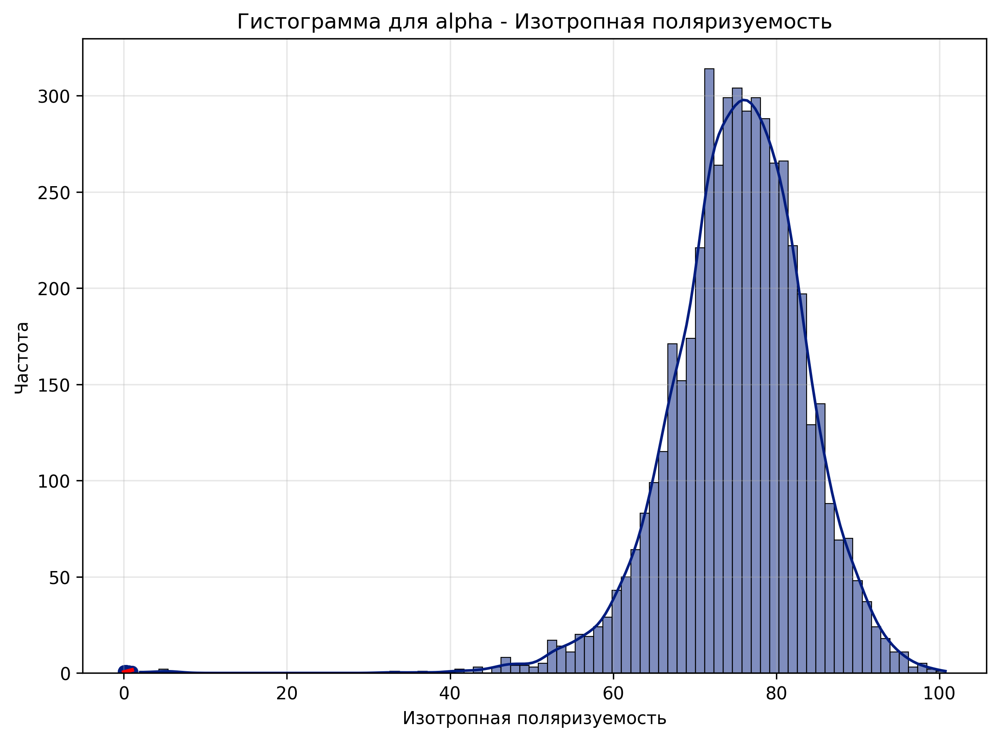
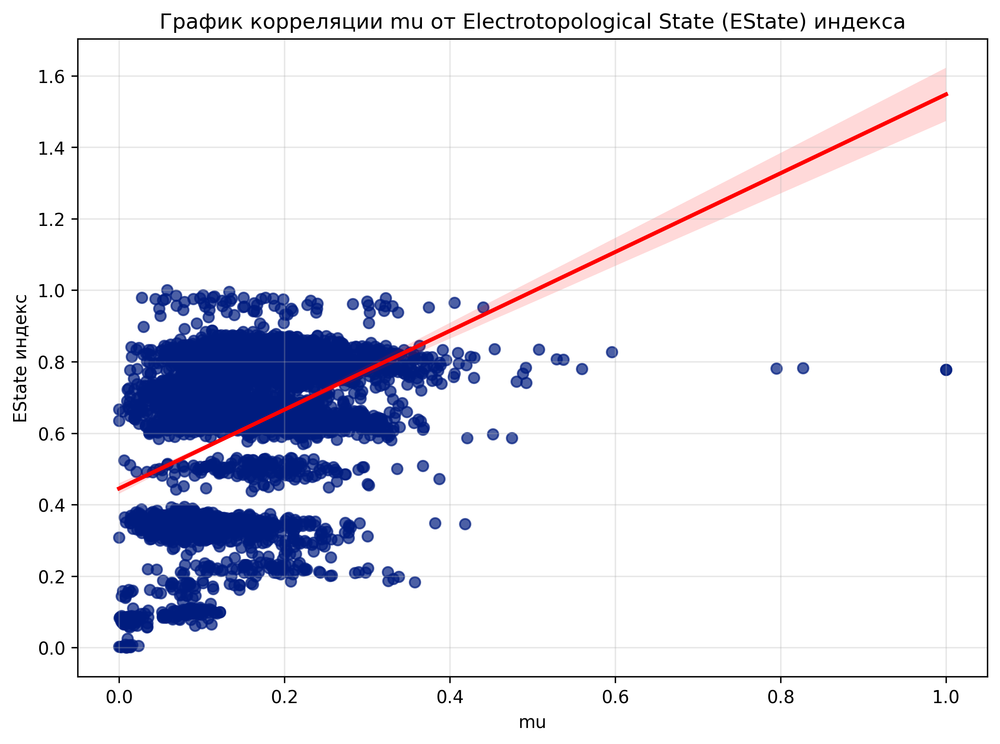
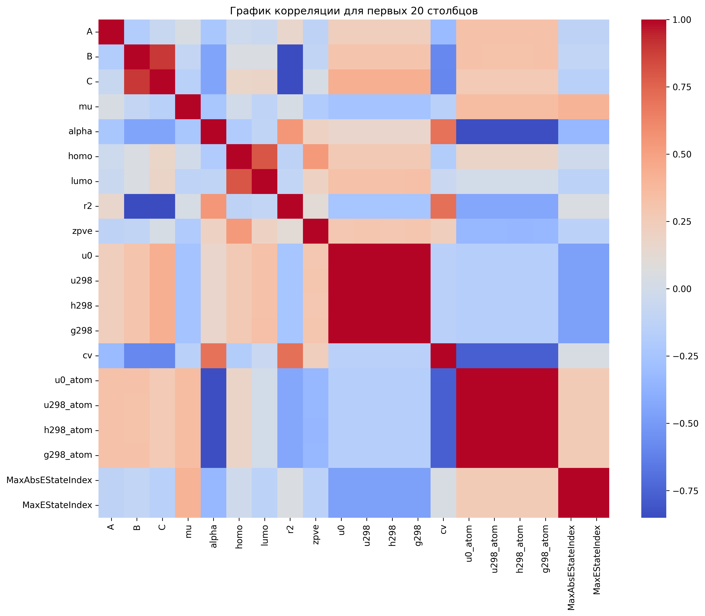
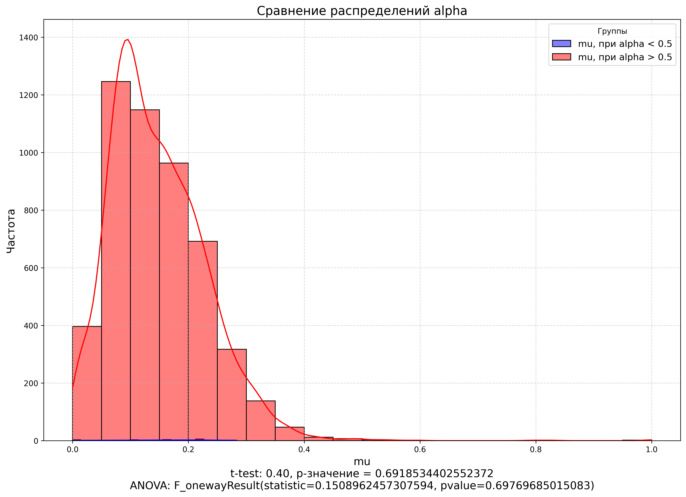

# Описание проекта
## Общее описание проекта
### Цель проекта:
Создание платформы, которая поможет в организации, структуризации, и анализе результатов лабораторных исследований, за счет получения дополнительных дескрипторов, очистки данных, предобработки и статистического анализа.
### Проект выполнили:
Кутявин Кирилл, Индустриальная биотехнология (Almet Tech)

Гребенкина Полина, Индустриальная биотехнология (Almet Tech)
## Описание структуры проекта
- код на питон - исходные Python-файлы без изменений
  - `main.py` - Главный файл.
  - `Telegram.py` - Запуск и работоспособность Телеграм-бота.
  - `pipeline.py` - Пайплайн для обработки, очистки, сохранения и построения графиков.
  - `cleaning.py` - Функции, отвечающие за очистку данных
  - `graphs.py` - Построение графиков
- код на ipynb - ноутбуки с выводами
  - `01_Расчеты_и_база.ipynb` - входные данные, дескрипторы RDKit и PubChem, очистка, запись и просмотр SQLite.
  - `02_Графики.ipynb` - нормализация, t-тест, ANOVA и четыре графика по отдельным ячейкам.
- `requirements.txt` - исходный список зависимостей.
- `requirements-notebooks.txt` - зависимости для ноутбуков.
- data - все изначальные и полученные данные
  - `Chem.db` - БД SQLite, содержащая таблицы:
      - "Original" - с оригинальными данными.
      - "Descriptors" - с данными после получения дескрипторов.
      - "Results" - с данными после очистки.
  - `data.csv` - Исходный файл.
  - `new` - DF с новым, вводимым веществом.
  - `Screenshot.png` - Информация о необходимых к вводу данных.
- dist - Прочие файлы.
- graphs - Последние и актуальные графики.


## Запуск программы

### Ноутбуки

Из корня проекта:

```bash
python3 -m venv .venv
.venv/bin/python -m pip install -r requirements-notebooks.txt
.venv/bin/python -m ipykernel install --prefix .venv --name dataengineering --display-name "DataEngineering"
```

Откройте ноутбуки в Jupyter или VS Code и выберите ядро DataEngineering. Порядок запуска: `01_Расчеты_и_база.ipynb`, затем `02_Графики.ipynb`. Ячейки выполняются сверху вниз. Выводы сохраняются внутри ноутбуков.

Для выполнения из терминала:

```bash
.venv/bin/jupyter nbconvert --to notebook --execute --inplace --ExecutePreprocessor.kernel_name=dataengineering --ExecutePreprocessor.timeout=600 "код на ipynb/01_Расчеты_и_база.ipynb"
.venv/bin/jupyter nbconvert --to notebook --execute --inplace --ExecutePreprocessor.kernel_name=dataengineering --ExecutePreprocessor.timeout=600 "код на ipynb/02_Графики.ipynb"
```

Для запросов PubChem нужен интернет. Дескрипторы вычисляются для строки из `data/new`, как в исходном проекте. Таблица с PubChem из `dist/Результат` показывается отдельно: исходная `desc()` возвращает только `df_1`.

Ноутбуки работают в папке `код на ipynb/_run` с копиями `data`, `dist` и `graphs`. Первый ноутбук обновляет копию перед запуском. Второй использует эту же копию, а при отдельном запуске копирует исходную базу. Исходная `data/Chem.db` не перезаписывается. Рабочая папка исключена из Git.

Функции из Python перенесены без изменения вычислений. Длинные комментарии в ноутбуках убраны, добавлены короткие подписи. Задачи Prefect вызываются через `.fn`, без запуска сервера. Тело `graphs()` разложено на ячейки, поэтому графики видны по отдельности. Исходные особенности очистки сохранены: `cleaning()` не присваивает возвращаемые значения `null()`, `Quantile()` и `disp()`.

### Telegram.py
- Необходимо ввести свой токен в 14 строку `TOKEN = 'YourToken'`, запустить файл и в своем боте написать ```/start```
- Если нет желания возиться с токеном, попросите меня(автора) запустить бота `@TrippyBubbleBot`, после чего введите команду `/start`
### main.py[dist](dist)
- Из корня проекта: `python3 "код на питон/main.py"`.

## Работоспособность
Запуск пайплайна с бота и ввод данных


Графики





## Выполнение задач

### Определение области проекта
- Домен - лабораторные исследования, химическая лаборатория.
- Решение проблемы анализа большого количества данных, полученных в лаборатории. В том числе, из-за добавления новых экспериментальных данных, приходится все пересчитывать и анализировать с начала. Как например, вчерашний выброс, после добавления новых веществ, уже не является выбросом и влияет на другие параметры.

### 1. Сбор данных
- Нам был предоставлен внутренний ДатаСет нашей лаборатории, которая успела провести некоторые исследования до нашего поступления.
- Новые данные будут добавляться посредством выполнения лабораторных работ.


### 2. Исследовательский анализ данных
#### Парсинг дескрипторов
#### 2.1 RDkit
Получение всех возможных дескрипторов с помощью ```Descriptors.descList```.
#### 2.2 PubChemPy
Добавление дескрипторов, которые уникальны для PubChemPy:
```properties = ['XLogP',                # Коэффициент распределения октанол-вода (логарифмическое значение)
    'ExactMass',            # Точная масса
    'MonoisotopicMass',     # Моноизотопная масса
    'TPSA',                 # Полярная площадь поверхности
    'Complexity',           # Сложность структуры
    'Charge',               # Заряд молекулы
    'HBondDonorCount',      # Количество доноров водородных связей
    'HBondAcceptorCount',   # Количество акцепторов водородных связей
    'RotatableBondCount',   # Количество вращаемых связей
    'HeavyAtomCount',       # Количество тяжелых атомо
    'IsotopeAtomCount',     # Количество атомов изотопов
    'AtomStereoCount',      # Общее количество стереоатомов
    'DefinedAtomStereoCount',   # Определенное количество стереоатомов
    'UndefinedAtomStereoCount', # Неопределенное количество стереоатомов
    'BondStereoCount',          # Общее количество стереосвязей
    'DefinedBondStereoCount',   # Определенное количество стереосвязей
    'UndefinedBondStereoCount', # Неопределенное количество стереосвязей
    'CovalentUnitCount'        # Количество ковалентных единиц
```
#### 2.3 Добавление одного нового вещества
- Возможность ввести новое вещество посредством Телеграм-бота, используя следующую таблицу с необходимыми данными.
- Структура данных:

| Параметр | Единицы | Описание                                       |
  |----------|:--------|------------------------------------------------|
  | **smiles** | - | Представление молекулы                         |
  | **A** | GHz | Ротационная константа                          |
  | **B** | GHz | Ротационная константа                          |
  | **C** | GHz | Ротационная константа                          |
  | **mu** | D | Дипольный момент                               |
  | **alpha** | - | Изотропная поляризуемость (Целевой показатель) |
  | **homo** | Ha | Энергия HOMO                                   |
  | **lumo** | Ha | Энергия LUMO                                   |
  | **gap** | Ha | Разница энергий HOMO и LUMO                    |
  | **r2** | - | Пространственное распределение электронов      |
  | **zpve** | Ha | Энергия нулевых колебаний                      |
  | **u0** | Ha | Внутренняя энергия при 0 К                     |
  | **u298** | Ha | Внутренняя энергия при 298.15 К                |
  | **h298** | Ha | Энтальпия при 298.15 К                         |
  | **g298** | Ha | Свободная энергия при 298.15 К                 |
  | **cv** | - | Теплоемкость при 298.15 К                      |


### 3. Предобработка данных
#### 3.1 Валидация
- После добавления дескрипторов в базу данных, необходимо проверить, что все данные в нужном формате.

#### 3.2 Обработка дубликатов
- Дубликаты удаляются

#### 3.3 Обработка недостающих значений
- Если в столбце 70% пропусков - удаляем их, так как это высоко для статистических методов.
- Если в столбце менее 30% пропусков, заполняются средним значением.

#### 3.4 Поиск выбросов
- Выбросами считаются значения, если они вне полутора межквартального размаха (1,5 * IQR).
- Удаляются строки, если хоть одно значение в его дескрипторах является выбросом.

#### 3.5 Анализ дисперсии
- Так как столбец ```'gap'``` является целевым, его значения не учитываются.
- Столбцы с дисперсией ниже 0.1 удаляются.

#### 3.6 Нормализация данных
- Используется ```MinMaxScaler``` маштабирование, которое переводит значения в каждом числовом столбце в диапазон от 0 до 1.


### 4. Определение и обоснование метрик качества данных.
Визуализация проводилась с использованием Seaborn
#### 4.1 Просмотр графика распределения Изотропной поляризуемости
#### 4.2 Построение графика кореляции `'mu'` - целевого показателя.
- Данный показатель зависит от максимального индекса электронной плотности, что мы и проверяем.
#### 4.3 Построение графика кореляции для первых 20 признаков (Те, что мы вводили сами).
- Просмотр зависимостей среди измеряемых нами в лаборатории признаков и свойств.
#### 4.4 Тест анализа различий между группами данных
- Выполняем независимый t-тест между `'mu'` У которых `'alpha'` меньше и больше 0
- ANOVA, для сравнения этих групп
- Все данные статистических тестов подписаны под графиком.


### 5. Разработка базы данных для хранения данных.
#### 5.1 SQLite
- Папка `data` - все изначальные и полученные данные
  - `Chem.db` - БД SQLite, содержащая таблицы:
      - "Original" - с оригинальными данными.
      - "Descriptors" - с данными после получения дескрипторов.
      - "Results" - с данными после очистки.

### 6. Оформление отдельного пайплайна для автоматизации.
#### 6.1 Telegram-бот
  - Ввод данных и запуск пайплайна производятся через него и кнопку `Начать ввод данных`
#### 6.2 Prefect
  - `pipeline.py` - Пайплайн для обработки, очистки, сохранения и построения графиков.

### 7. Оформление дашборда.
#### Telegram-бот
- Так как наши данные большую часть времени статичны, и обновлять их нужно только после добавление нового вещества, что делается из бота, то логичным решением будет получение необходимых метрик так же внутри бота.
- Получение актуальных и необходимых графиков проимходит посредством нажатия на кнопку `Посмотреть графики`.


### 8. Оформление презентации/пояснительной записки
- Прямо сейчас вы читаете пояснительную записку).
